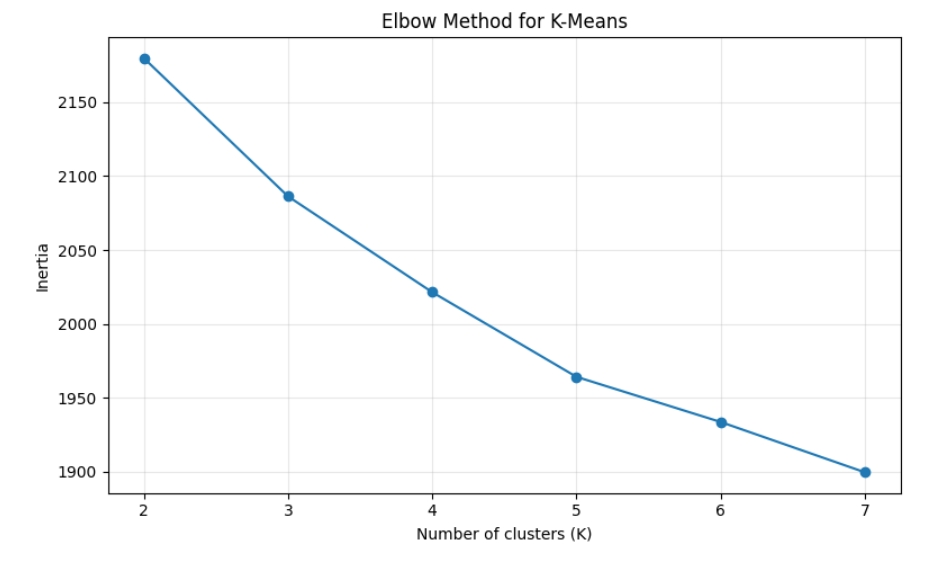

# US Airline Twitter Sentiment Analysis

## Project Overview

This project explores sentiment analysis of airline-related tweets using Natural Language Processing (NLP), supervised machine learning, and unsupervised learning techniques.

Using a dataset of 14,640 tweets covering six US airlines, the objective is to classify customer opinions into three sentiment categories — negative, neutral, and positive — and investigate patterns in customer feedback.

The project combines text preprocessing, exploratory data analysis, classification models, and clustering techniques to extract meaningful insights from unstructured social media data.

## Dataset

- **Source:** US Airline Twitter Sentiment Dataset (Kaggle)
- **Observations:** 14,640 tweets
- **Airlines:** 6
- **Target variable:** Airline sentiment
- **Sentiment classes:** Negative, Neutral, Positive

### Sentiment Distribution

| Sentiment | Number of tweets | Percentage |
|---|---:|---:|
| Negative | 9,178 | 62.7% |
| Neutral | 3,099 | 21.2% |
| Positive | 2,363 | 16.1% |

The dataset is imbalanced, with negative tweets representing the majority class.

## Methodology

### 1. Data Cleaning and Text Preprocessing

- Removed unnecessary columns and irrelevant information.
- Removed Twitter mentions and URLs.
- Removed punctuation and special characters.
- Converted text to lowercase.
- Tokenized tweets.
- Removed stopwords and short tokens.

### 2. Exploratory Data Analysis

- Sentiment distribution analysis.
- Negative customer feedback analysis.
- Sentiment distribution across airlines.
- Word clouds for each sentiment category.
- Identification of the most frequent words per sentiment.

### 3. Supervised Machine Learning

Three classification approaches were explored:

**Custom Multinomial Naive Bayes**
- Implemented the Multinomial Naive Bayes algorithm from scratch.
- Used word frequencies and Laplace smoothing.
- Evaluated predictions using a classification report and confusion matrix.

**TF-IDF + Logistic Regression**
- Applied TF-IDF vectorization for text representation.
- Trained a Logistic Regression classifier.
- Evaluated classification performance.

**TF-IDF + Balanced Logistic Regression**
- Used `class_weight='balanced'` to address class imbalance.
- Compared performance against standard Logistic Regression.
- Evaluated accuracy, balanced accuracy, precision, recall, and macro F1-score.

The dataset was divided into training and testing sets using an 80/20 stratified split.

### 4. Unsupervised Learning

**PCA + K-Means Clustering**

- Applied PCA to reduce the dimensionality of TF-IDF features.
- Retained 50 principal components.
- Used the Elbow Method to investigate the number of clusters.
- Applied K-Means with three clusters.
- Evaluated clustering using purity and silhouette score.
- Compared cluster assignments with actual sentiment labels.

## 📊 Project Visualizations

### 1. Overall Sentiment Distribution


### 2. Sentiment Analysis by Airline


### 3. Reasons for Negative Tweets


### 4. Sentiment Categories Analysis

**Negative Tweets**


**Neutral Tweets**


**Positive Tweets**


### 5. Machine Learning Classification

**Balanced Logistic Regression**


**Logistic Regression Confusion Matrix**


**Naive Bayes Confusion Matrix**


### 6. Unsupervised Learning — K-Means



## Results

### Supervised Model Comparison

| Model | Accuracy | Balanced Accuracy | Macro F1 |
|---|---:|---:|---:|
| Custom Multinomial Naive Bayes | 0.77 | — | 0.66 |
| Logistic Regression | 0.7889 | 0.6754 | 0.7091 |
| Balanced Logistic Regression | 0.7551 | 0.7299 | 0.7111 |

**Key finding:** Standard Logistic Regression achieved the highest accuracy (78.89%), while balanced Logistic Regression achieved better balanced accuracy and macro F1-score.

Class weighting improved the model's ability to recognize minority sentiment classes.

### Balanced Logistic Regression — Classification Performance

| Sentiment | Precision | Recall | F1-score |
|---|---:|---:|---:|
| Negative | 0.89 | 0.79 | 0.83 |
| Neutral | 0.53 | 0.69 | 0.60 |
| Positive | 0.69 | 0.71 | 0.70 |

### Clustering Results

| Metric | Result |
|---|---:|
| Number of clusters | 3 |
| PCA components | 50 |
| Explained variance | 15.79% |
| Clustering purity | 66.47% |
| Silhouette score | 0.1824 |

The clustering results show moderate agreement with the actual sentiment labels, while the silhouette score indicates limited cluster separation.

## Business Insights

The exploratory analysis revealed several patterns:

- Customer service issues were the most frequent negative feedback category.
- Late flights and cancelled flights were also major sources of dissatisfaction.
- Virgin America had the highest positive sentiment proportion among the airlines.
- United and US Airways accounted for large numbers of negative tweets.

These findings demonstrate how social media analytics can help airlines identify recurring customer concerns and understand customer perceptions.

## Technologies and Libraries

- Python
- Pandas
- NumPy
- Matplotlib
- Seaborn
- WordCloud
- Scikit-learn
- Google Colab
- Natural Language Processing (NLP)

## Repository Structure

```text
US-Airline-Twitter-Sentiment-Analysis/
│
├── README.md
├── requirements.txt
│
├── notebooks/
│   └── airline_sentiment_analysis.ipynb
│
├── reports/
│   └── project_report.pdf
│
└── images/
    ├── sentiment_distribution.png
    ├── negative_reasons.png
    ├── airline_sentiment.png
    ├── wordclouds.png
    ├── confusion_matrix.png
    └── clustering_results.png
```

## How to Run

1. Open the notebook using Google Colab.
2. Upload the `Tweets.csv` dataset when prompted.
3. Run the notebook cells in order.
4. Review the exploratory analysis, classification results, and clustering evaluation.

## Team Members

- Molka Ouelhezi
- Nour Gaja
- Ons Guizani

**Academic Project — Tunis Business School**  
Business Analytics Program | Spring 2025–2026

---

*Note: Reported model metrics correspond to the current notebook execution. Results may vary when preprocessing or model configurations change.*
